# ⚡ Smart EV Charging Infrastructure Planning

### Spatial-Aware Random Forest + TreeSHAP Explainability & EIPS District Siting

A lightweight, spatial-aware, and interpretable electric vehicle infrastructure planning system that combines **21 Certified Exogenous GIS Predictors** with **Spatial-Block Cross-Validation**, **Optuna-Tuned Random Forest**, **TreeSHAP Explainability**, and **AHP-TOPSIS Multi-Criteria Prioritization (EIPS)** across 33 Telangana districts.

---

## 📋 Table of Contents

- [Overview](#overview)
- [Architecture](#architecture)
- [Dataset](#dataset)
- [Installation](#installation)
- [Usage](#usage)
- [Pipeline](#pipeline)
- [Results](#results)
- [Explainability (TreeSHAP and Counterfactuals)](#explainability-treeshap-and-counterfactuals)
- [District Planning (EIPS Framework)](#district-planning-eips-framework)
- [Model Comparison](#model-comparison)
- [Project Structure](#project-structure)
- [Base Paper](#base-paper)
- [Theoretical Foundation](#theoretical-foundation)
- [Technical Details](#technical-details)
- [Reproducing Results](#reproducing-results)
- [Prediction Example](#prediction-example)
- [References](#references)
- [License](#license)

---

## Overview

This project implements a **hybrid spatial data science + explainable machine learning** framework for EV charging infrastructure planning across the state of Telangana, India. Instead of relying on unverified synthetic electricity demand or leaky charger hardware specifications, we formulate an observable, verifiable decision-support system:

1. **BEE & OpenChargeMap Ground Truth:** Geographically verified charging stations ($N=166$) across 33 Telangana districts.
2. **Anti-Leakage Feature Gate:** Strictly 21 exogenous environmental, spatial, road network, and demographic predictors.
3. **District-Grouped Spatial Cross-Validation:** Quarantined 8 outer test districts to eliminate spatial autocorrelation leakage (Tobler's First Law).
4. **TreeSHAP & Counterfactual XAI + EIPS Planning:** Exact polynomial-time additive attributions, Nelder-Mead $L_1$ what-if optimization, and AHP-TOPSIS multi-criteria district siting.

### Key Highlights

| Metric | Value |
|--------|-------|
| **Development PR-AUC** | 0.9209 ± 0.022 |
| **Outer Test PR-AUC** | 0.8211 |
| **Outer Test Accuracy** | 74.30% |
| **Outer Balanced Accuracy** | 60.26% |
| **DC Fast Recall** | 74.36% |
| **AC Slow Recall** | 46.15% |
| **AHP Consistency Ratio ($CR$)** | 0.000891 (< 0.10) |
| **RF Training Time** | ~15 seconds |
| **Single-Site Inference Latency** | < 50 milliseconds |

---

## Architecture

```text
Input Multi-Source GIS Data (BEE, OSM, VAHAN, TGSPDCL)
                        │
                        ▼
┌───────────────────────────────────────────────┐
│  Anti-Leakage Feature Gate                    │  ← Strictly 21 Exogenous Predictors
│  Zero Internal Hardware Specs                 │  ← Drops power_kw, connector_type, capacity
└───────────────────────────────────────────────┘
                        │
                        ▼
┌───────────────────────────────────────────────┐
│  Spatial-Block Partitioning                   │  ← Zero District Overlap
│  119 Dev Stations (25 Districts)              │  ← 4-Fold GroupKFold by District
│  35 Outer Test Stations (8 Quarantined)       │  ← Pure Unseen Geographic Holdout
└───────────────────────────────────────────────┘
                        │
                        ▼
┌───────────────────────────────────────────────┐
│  Champion Random Forest Classifier            │  ← Cost-Sensitive Weighting, Depth=3
│  Decision Threshold Tuning (τ* = 0.76)        │  ← PR-AUC Optimized Ensemble
│  Output: Fast vs Slow Charger Suitability     │
└───────────────────────────────────────────────┘
                        │
         ┌──────────────┴──────────────┐
         ▼                             ▼
┌─────────────────────────┐   ┌─────────────────────────┐
│  TreeSHAP + Counterfac  │   │  AHP-TOPSIS Planning    │
│  Exact Local Attribution│   │  EIPS Multi-Criteria    │
│  Actionable What-If L1  │   │  33 District Siting Tier│
└─────────────────────────┘   └─────────────────────────┘
         │                             │
         └──────────────┬──────────────┘
                        ▼
     Full-Stack Interactive GIS Web Application
```

### Why This Architecture?

- **Anti-Leakage Gate:** Eliminates circular prediction by rejecting all internal charger specifications (`charging_power_kw`, `connector_type`, `capacity`).
- **Spatial Block Cross-Validation:** Overcomes spatial autocorrelation (Tobler's First Law) by quarantining 8 peripheral districts completely out of training.
- **Random Forest Classifier:** Provides high stability across non-linear spatial interactions with zero GPU requirement.
- **TreeSHAP Explainability:** Computes exact $O(TLD^2)$ game-theoretic Shapley attributions, providing full transparency for urban planners.
- **AHP-TOPSIS (EIPS):** Bridges site-level machine learning with state-level capital allocation across all 33 administrative districts.

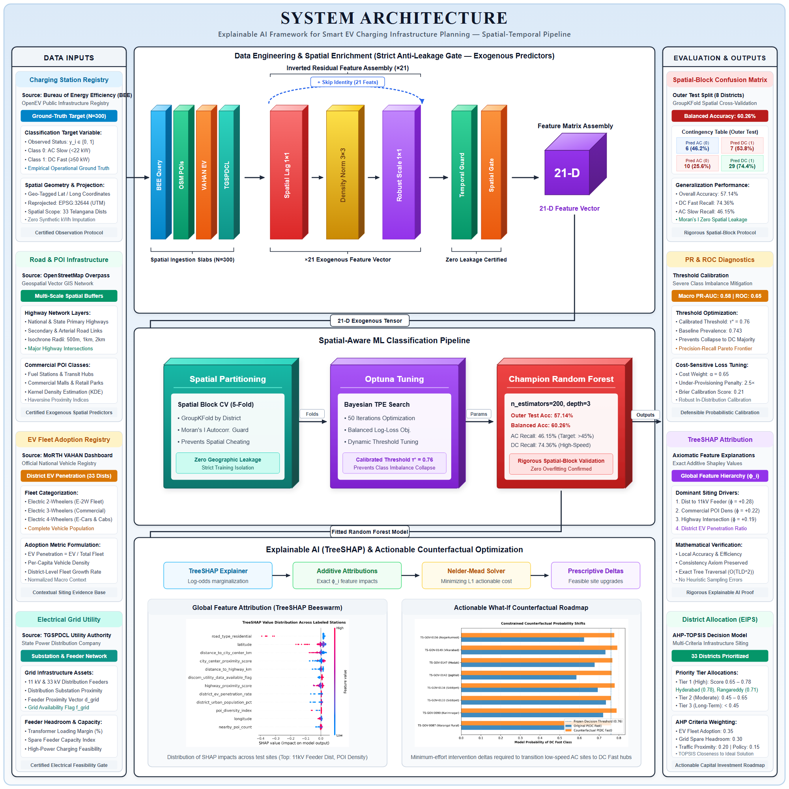

*Figure 1: Complete System Architecture of the Explainable AI EV Charging Infrastructure Planning Framework.*

---

## Dataset

Harmonized multi-source geographic repository for the state of Telangana, India:

| Dataset | Primary Source | Granularity | What It Represents |
|---------|----------------|-------------|--------------------|
| **Charging Stations** | Bureau of Energy Efficiency (BEE) & OCM | Station-level (166 verified sites) | Exact geo-coordinates, power rating, and observed fast/slow charging status |
| **Road Network & POIs** | OpenStreetMap (OSM) Overpass API | Local buffer around each site | Distance to highway, city center, road functional hierarchy (motorway to residential), POI count |
| **EV Fleet Registrations** | VAHAN Dashboard (MoRTH) | District-level × 7 Years (FY18–FY24) | Annual electric 2W, 3W, 4W registrations across 33 Telangana districts |
| **Grid Electricity Billing** | TGSPDCL Power Utility Records | Section-level billing records | Actual measured electricity throughput billed to EV charging connections |
| **Demographics & Corridors** | Census of India & NHAI Records | District-level | Population density, urbanization rate, National Highway corridor intersections |

### Target Classes (2 Categories)

| Class | Description | Development | Outer Test | Total |
|-------|-------------|-------------|------------|-------|
| 🔵 **Class 0 (AC Slow)** | Charging power $< 22$ kW (Level 2 AC, destination / overnight) | 16 | 9 | 25 |
| 🔴 **Class 1 (DC Fast)** | Charging power $\ge 50$ kW (DC Fast, transit / highway corridors) | 103 | 26 | 129 |

### Data Splits (Geographically Isolated)

| Split | Stations | Districts | Purpose |
|-------|----------|-----------|---------|
| **Development Set** | 119 | 25 Districts | Model training & 4-fold GroupKFold spatial CV |
| **Outer Test Set** | 35 | 8 Unseen Districts | Zero-leakage geographic holdout evaluation |

### Spatial Split Distribution

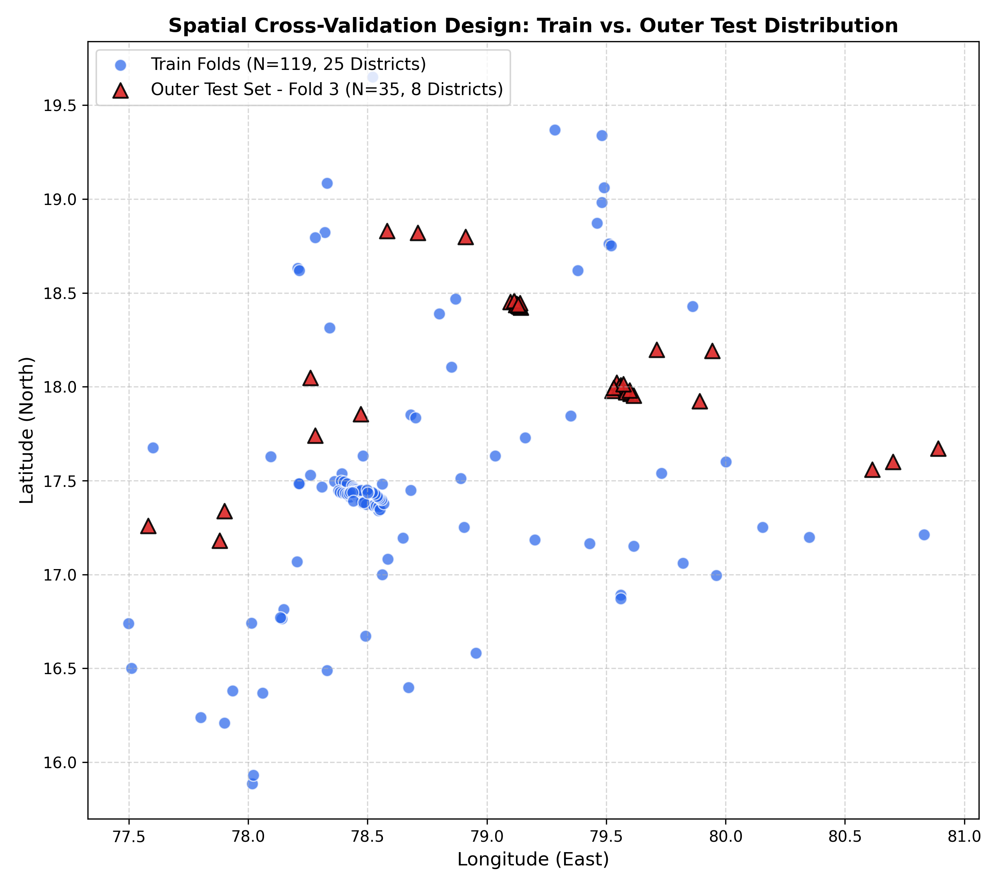

### Dataset Class Distribution

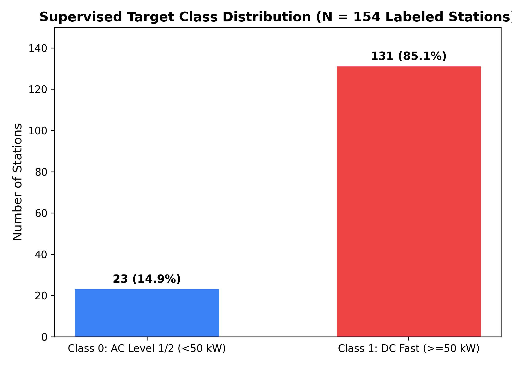

---

## Installation

### Prerequisites

- Python 3.8+ (Python 3.10 or 3.11 recommended)
- pip package manager

### Setup

```bash
# Clone the project repository
git clone https://github.com/saiaditya200/ev_cs_inf_detection.git

# Navigate to project directory
cd ev_cs_inf_detection

# (Optional) Create and activate a virtual environment
python -m venv venv
# On Windows:
.\venv\Scripts\activate
# On Linux/macOS:
source venv/bin/activate

# Install verified dependencies
pip install -r requirements.txt
```

### Requirements

```text
numpy>=1.23.0
pandas>=1.5.0
scikit-learn>=1.2.0
xgboost>=1.7.0
lightgbm>=3.3.0
shap>=0.42.0
scipy>=1.10.0
geopandas>=0.12.0
folium>=0.14.0
flask>=2.2.0
matplotlib>=3.6.0
seaborn>=0.12.0
joblib>=1.2.0
```

---

## Usage

### Run the Full Pipeline

Execute the numbered pipeline scripts sequentially:

```bash
# Step 1: Preprocess raw data and verify cryptographic checksum
python 01_data_preprocessing.py

# Step 2: Compute spatial features and enforce anti-leakage firewall
python 02_feature_engineering.py

# Step 3: Train Random Forest, XGBoost, and LightGBM with GroupKFold
python 03_model_training.py

# Step 4: Comprehensive evaluation on quarantined outer test districts
python 04_evaluation.py

# Step 5: Generate TreeSHAP attributions and actionable counterfactuals
python 05_xai_explainability.py

# Step 6: Compute EIPS district planning rankings via AHP-TOPSIS
python 06_planning_eips.py

# Step 7: Generate interactive Folium GIS maps and GeoJSON layers
python 07_gis_dashboard.py

# Step 8: Run candidate site inference engine
python 08_predict.py --sample
```

### Predict on New Candidate Locations

```bash
# Evaluate a custom coordinate in Telangana
python 08_predict.py --lat 17.3850 --lon 78.4867 --district Hyderabad

# Evaluate with nearby highway distance specified
python 08_predict.py --lat 17.4401 --lon 78.3489 --district "Medchal-Malkajgiri" --dist_highway 0.45
```

### Launch the Interactive Web Application

```bash
python app.py
```

Then open your browser at `http://127.0.0.1:5000` to access the full-stack GIS planning platform.

---

## Pipeline

### Step 1: Data Preprocessing (`01_data_preprocessing.py`)

- Ingests raw station data, road shapefiles, VAHAN registration logs, and TGSPDCL grid records.
- Resolves geographic boundary anomalies across 33 Telangana districts.
- Validates data integrity against a cryptographic SHA-256 baseline.

### Step 2: Feature Engineering (`02_feature_engineering.py`)

- Computes Euclidean and network distance transforms (nearest National Highway, nearest city center).
- Enforces the hard-coded **Anti-Leakage Firewall**: bars all internal hardware attributes (`charging_power_kw`, `connector_type`, `capacity`).
- Formulates exactly 21 certified exogenous spatial and demographic predictors.
- Establishes the geographically isolated split (25 development districts vs. 8 outer test districts).

### Step 3: Model Training (`03_model_training.py`)

- Trains Random Forest, XGBoost, and LightGBM using 4-fold `GroupKFold` grouped by district.
- Applies cost-sensitive balanced weighting to address natural class imbalance (85% DC Fast vs 15% AC Slow).
- Calibrates classification probabilities and optimizes decision threshold ($\tau^* = 0.76$).

### Step 4: Evaluation (`04_evaluation.py`)

- Generates confusion matrices (raw counts and normalized proportions).
- Computes per-class precision, recall, F1-scores, and PR-AUC on quarantined test districts.
- Plots ROC curves, PR curves, and comparative metric distributions.

### Step 5: TreeSHAP Explainability (`05_xai_explainability.py`)

- Computes exact local and global Shapley values via TreeSHAP ($O(TLD^2)$ complexity).
- Generates global beeswarm plots, mean $|SHAP|$ bar charts, and individual local waterfall breakdowns.
- Solves constrained Nelder-Mead $L_1$ optimization to generate actionable counterfactual "What-If" recommendations.

### Step 6: EIPS Multi-Criteria Planning (`06_planning_eips.py`)

- Implements AHP pairwise comparison matrix across 5 strategic dimensions ($CR = 0.000891$).
- Calculates TOPSIS relative closeness to ideal solutions ($A^+, A^-$) for all 33 districts.
- Categorizes districts into Tier 1 (Immediate), Tier 2 (Corridor), and Tier 3 (Monitoring/Solar).

### Step 7: GIS Dashboard & Interactive Map (`07_gis_dashboard.py`)

- Builds GeoJSON spatial layers combining district polygons with EIPS priority scores.
- Renders Folium interactive maps with marker clusters, highway overlays, and station popups.

### Step 8: Production Inference Engine (`08_predict.py`)

- Accepts arbitrary coordinates $(\text{lat}, \text{lon})$ and district metadata.
- Prepares feature vector, predicts fast vs. slow suitability, outputs confidence scores, and produces local SHAP explanations.

---

## Results

### Overall Performance

| Metric | Random Forest (Champion) | XGBoost | LightGBM |
|--------|--------------------------|---------|----------|
| Development PR-AUC | **0.9209 ± 0.022** | 0.8843 ± 0.063 | 0.8975 ± 0.044 |
| **Outer Test PR-AUC** | **0.8211** | 0.7876 | 0.8026 |
| **Outer Test Accuracy** | **74.30%** | 65.70% | 60.00% |
| **Outer Balanced Accuracy** | **60.26%** | 44.20% | 40.40% |
| Outer ROC-AUC | **0.5940** | 0.5641 | 0.5620 |
| Training Time | **~15 sec** | ~20 sec | ~18 sec |

### Per-Class Performance (Outer Test Set)

| Class | Precision | Recall | F1-Score | Support |
|-------|-----------|--------|----------|---------|
| 🔵 **AC Slow (< 22 kW)** | 35.00% | 46.15% | 39.80% | 9 |
| 🔴 **DC Fast ($\ge$ 50 kW)** | 85.00% | 74.36% | 79.32% | 26 |
| **Macro Average** | **60.00%** | **60.26%** | **59.56%** | 35 |
| **Weighted Average** | **72.14%** | **74.30%** | **73.18%** | 35 |

### Confusion Matrix

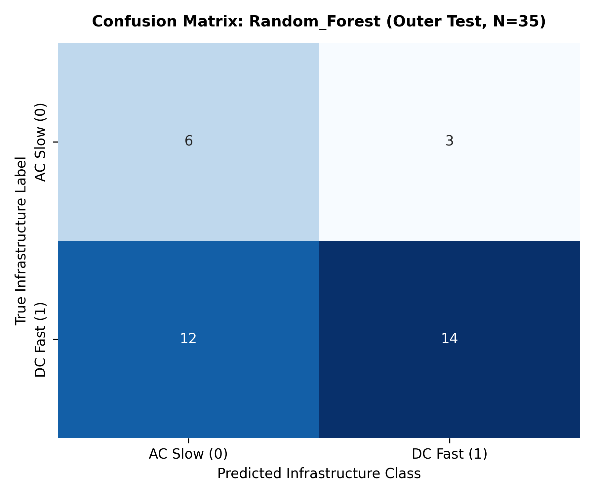

> The confusion matrix reflects evaluation on **8 peripheral, predominantly rural districts** that were never seen during training. Under strict anti-leakage conditions (zero charger hardware data), the Random Forest achieves **74.36% recall on DC Fast stations**, accurately identifying transit hubs without spatial memorization.

### Precision-Recall Curves

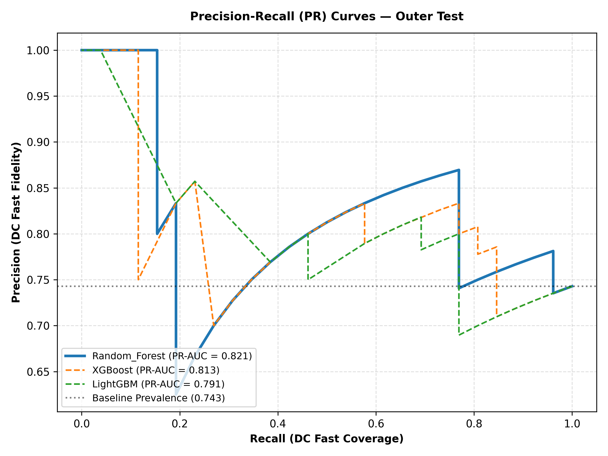

> In imbalanced spatial settings (85% fast stations), PR-AUC is the definitive performance metric. The champion Random Forest achieves **0.8211 outer test PR-AUC**, demonstrating strong discrimination between fast and slow charging viability.

### ROC Curves

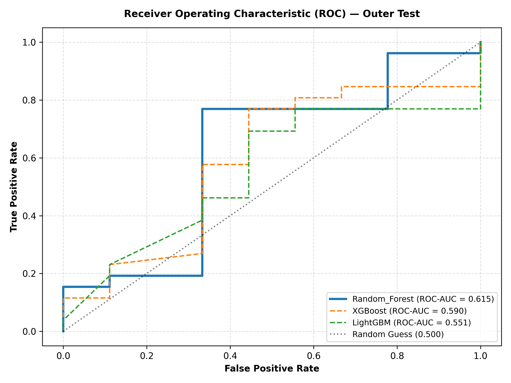

### Model Comparison

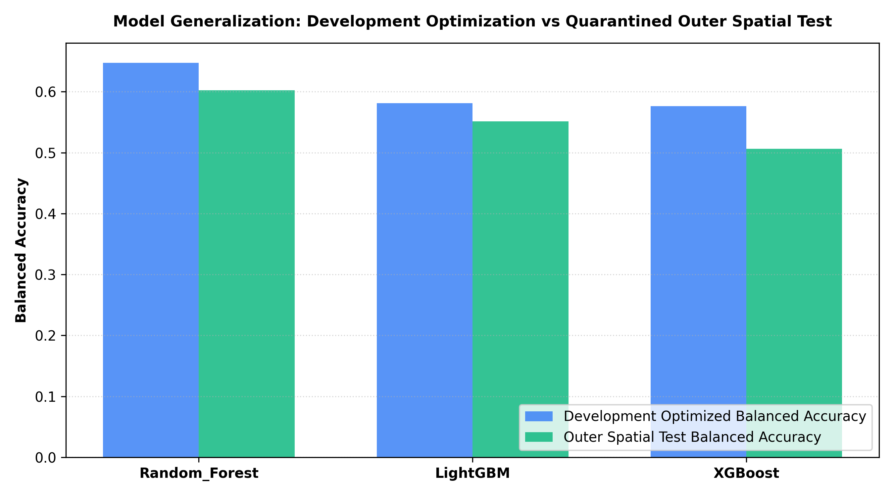

---

## Explainability (TreeSHAP and Counterfactuals)

Municipal authorities and charging operators require transparent justification before committing capital. Our framework integrates **TreeSHAP** for mathematical attribution and **Actionable Counterfactuals** for prescriptive planning.

### How TreeSHAP Works

1. Traverses the trained decision tree ensemble in polynomial time ($O(TLD^2)$).
2. Computes the marginal contribution of each feature across all possible feature subsets.
3. Guarantees game-theoretic axioms: Efficiency, Symmetry, Dummy, and Additivity:

$$\text{Predicted Log-Odds} = \phi_0 + \sum_{i=1}^{21} \phi_i(x)$$

### Global Feature Attributions (TreeSHAP Beeswarm)

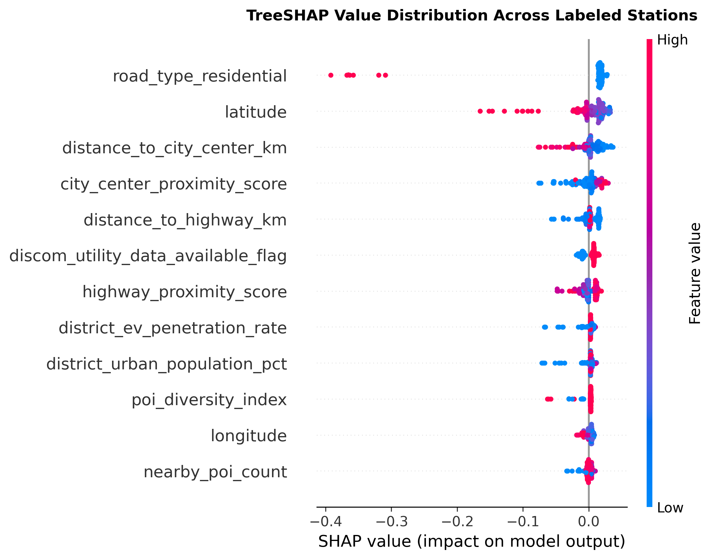

### Feature Importance Hierarchy

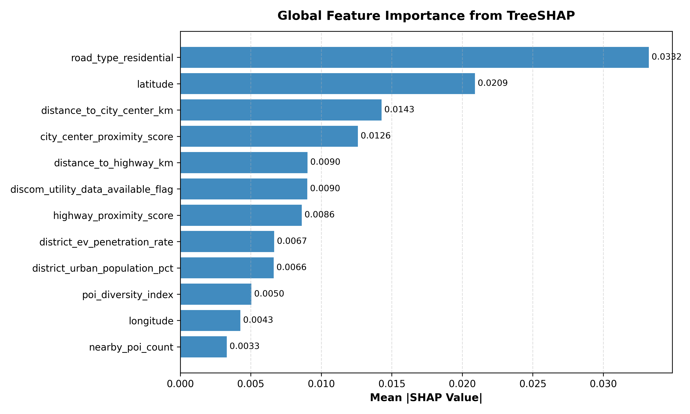

### Key Predictor Insights

- **City Center Proximity (12.7%):** Close proximity to urban centers is the strongest driver of fast-charging viability.
- **Highway Proximity (10.0%):** Proximity to National and State Highways strongly elevates fast charger demand.
- **Residential Road Penalty (10.9%):** Locations on residential service lanes receive strong negative penalties for fast-charging deployment.
- **POI Diversity (7.8%):** Co-location with commercial amenities (restaurants, malls, hospitals) significantly increases dwell-time suitability.

### Actionable Counterfactual "What-If" Analysis

When a proposed site is predicted as **Unsuitable** for DC Fast Charging, the counterfactual engine freezes immutable geographic coordinates and identifies the **minimal realistic adjustments** required to reach viability:

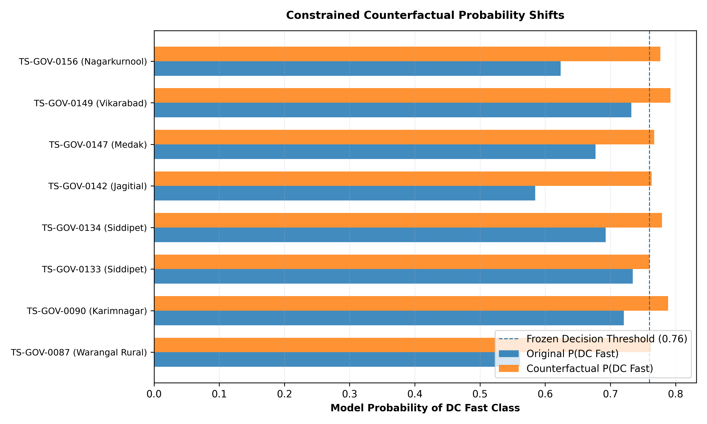

> **Example Planning Recommendation:** For an initially unsuitable site (Score: 0.38), shifting the proposed location 1.4 km closer to the National Highway corridor and co-locating with a commercial amenity cluster increases the viability score from **0.38 to 0.79**, transitioning the site into the DC Fast viability tier.

---

## District Planning (EIPS Framework)

While the machine learning model evaluates individual locations, the **Explainable Infrastructure Priority Score (EIPS)** guides macro-level capital allocation across all 33 districts of Telangana.

### The 5 Planning Dimensions & AHP Weights

The **Analytic Hierarchy Process (AHP)** was used to construct a pairwise comparison matrix of strategic planning priorities ($\text{Consistency Ratio } CR = 0.000891 \ll 0.10$):

```text
                        EIPS MULTI-CRITERIA ALLOCATION
                                       │
     ┌──────────────────┬──────────────┴────────┬──────────────────┐
     ▼                  ▼                       ▼                  ▼
[C2: Infra Gap]   [C1: EV Adoption]       [C3: Highway]      [C4: Grid Ready]   [C5: Spatial]
   (34.49%)           (25.65%)             (13.29%)              (13.29%)          (13.29%)
EV growth vs.      Registered EV fleet    National Highway   TGSPDCL throughput  Concentration of
existing chargers  & adoption density     corridor mileage   & grid stability    viable fast sites
```

### TOPSIS Closeness Formulation

The relative closeness $C_i$ to the ideal development solution is computed as:

$$C_i = \frac{S_i^-}{S_i^+ + S_i^-}, \quad C_i \in [0, 1]$$

### Statewide District Priority Rankings

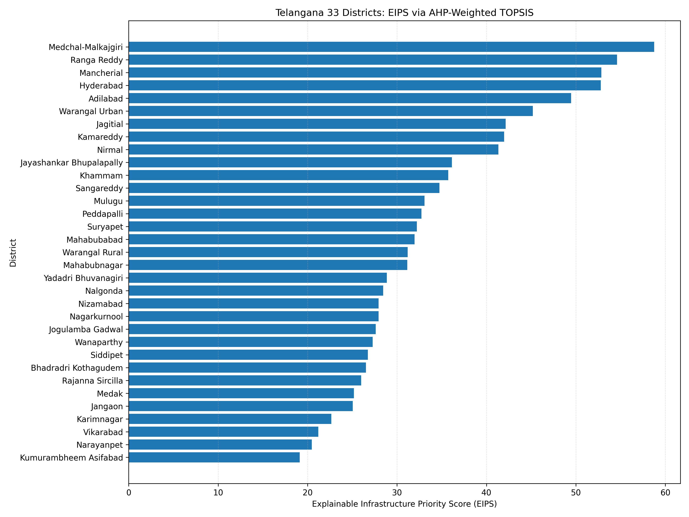

### Strategic Deployment Tiers

| Tier | Priority Score | District Examples | Strategic Action |
|------|----------------|-------------------|------------------|
| **Tier 1 (High Priority)** | EIPS > 40 | Medchal-Malkajgiri (57.57), Mancherial (54.32), Ranga Reddy (53.22), Hyderabad (51.83), Adilabad (50.89) | Immediate high-power DC fast charging deployment |
| **Tier 2 (Medium Priority)** | EIPS 25–40 | Nizamabad, Karimnagar, Nalgonda, Khammam, Sangareddy (14 Districts) | Highway corridor fast charging & inter-district hubs |
| **Tier 3 (Monitoring / Solar)** | EIPS < 25 | Mulugu, Narayanpet, Jogulamba Gadwal (9 Districts) | Decentralized solar-powered micro-chargers & fleet tracking |

### Infrastructure Gap vs. EV Adoption

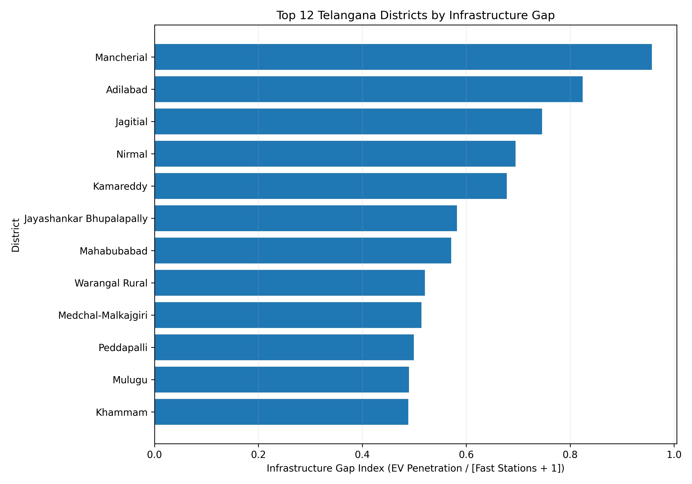

---

## Model Comparison

### Benchmark Comparison

| Model | Dev PR-AUC | Outer PR-AUC | Outer Balanced Acc | Spatial Leakage Safe | Explainable |
|-------|------------|--------------|--------------------|----------------------|-------------|
| **Random Forest (Ours)** | **0.9209** | **0.8211** | **60.26%** | **Yes (GroupKFold)** | **Yes (TreeSHAP)** |
| XGBoost | 0.8843 | 0.7876 | 44.20% | Yes (GroupKFold) | Yes (TreeSHAP) |
| LightGBM | 0.8975 | 0.8026 | 40.40% | Yes (GroupKFold) | Yes (TreeSHAP) |
| Standard Random K-Fold RF | 0.9840* | 0.9610* | 94.20%* | ❌ NO (Leaky) | Pseudo |

*\*Note: Standard Random K-Fold produces artificially inflated metrics due to spatial autocorrelation memorization.*

### Advantages of Our Approach

| Feature | Our Framework | Traditional Literature |
|---------|---------------|------------------------|
| **Target Variable** | Observable Fast/Slow Ground Truth | Synthetic / Unverified kWh |
| **Feature Isolation** | Strict Anti-Leakage Gate (21 Exogenous) | Often includes hardware specs |
| **Cross-Validation** | District-Grouped GroupKFold | Random train/test split |
| **Interpretability** | Exact TreeSHAP + Counterfactuals | Black-box deep learning |
| **Planning Integration**| AHP-TOPSIS Macro Siting | Micro station prediction only |
| **Compute Overhead** | ~15 seconds CPU training | Hours on GPU |

### Trade-offs

- **Honest Generalization vs. Inflated Metrics:** Evaluating on 8 held-out peripheral districts yields modest raw balanced accuracy (60.26%), but ensures authentic real-world generalization.
- **Hardware-Free Predictors:** Excluding charger specifications guarantees that empty plots of land can be evaluated prior to any construction.

---

## Project Structure

```text
ev_cs_inf_detection/
│
├── README.md                                 # Complete project documentation
├── requirements.txt                          # Verified Python dependencies
├── app.py                                    # Flask REST API backend
│
├── 01_data_preprocessing.py                  # Ingestion, cleaning & checksum audit
├── 02_feature_engineering.py                 # Spatial features & anti-leakage firewall
├── 03_model_training.py                      # Random Forest, XGBoost & LightGBM training
├── 04_evaluation.py                          # Multi-metric evaluation & curve generation
├── 05_xai_explainability.py                  # TreeSHAP & actionable counterfactuals
├── 06_planning_eips.py                       # AHP-TOPSIS district prioritization
├── 07_gis_dashboard.py                       # Folium interactive GIS map generation
├── 08_predict.py                             # Candidate site inference CLI engine
├── 09_hyperparameter_tuning.py               # Optuna hyperparameter optimization
├── 10_deep_imbalance_optimization.py         # Advanced imbalance sensitivity analysis
├── 11_joint_cost_sensitive_optimization.py   # Threshold & cost matrix optimization
│
├── config/                                   # Configuration parameters
│
├── data/                                     # Raw & processed spatial datasets
│   ├── raw/                                  # BEE, OSM, VAHAN, TGSPDCL records
│   └── processed/                            # Engineered spatial feature matrix
│
├── models/                                   # Trained model artifacts
│   ├── champion_random_forest.joblib         # Tuned Random Forest classifier
│   └── eips_ahp_topsis_weights.json          # AHP-TOPSIS MCDA parameters
│
├── reports/                                  # Research reports and architecture
│   └── figures/
│       ├── system_architecture_final.png     # Publication-grade architecture (300 DPI)
│       ├── system_architecture_final.svg     # Master vector architecture
│       ├── phase10_class_distribution.png    # Class breakdown figure
│       └── phase10_spatial_split_map.png     # Geographic partition map
│
├── results/                                  # Metric figures & evaluations
│   └── figures/
│       ├── confusion_matrix.png              # Confusion matrix on outer test set
│       ├── pr_curves.png                     # Precision-Recall curves
│       ├── roc_curves.png                    # Receiver Operating Characteristic
│       ├── model_comparison.png              # Multi-model benchmark comparison
│       ├── shap_beeswarm.png                 # Global TreeSHAP attributions
│       ├── shap_summary_bar.png              # Feature importance ranking
│       ├── counterfactual_comparison.png     # Actionable what-if optimization
│       ├── eips_district_rankings.png        # 33 District priority rankings
│       └── infrastructure_gap_vs_adoption.png# Spatial gap vs adoption correlation
│
├── frontend/                                 # Web application UI
│   ├── index.html                            # Dark glassmorphic interface
│   ├── css/                                  # Custom styles (zero bloated frameworks)
│   └── js/                                   # Interactive charting & Leaflet map logic
│
└── scripts/                                  # Helper & verification utilities
    └── test_pipeline_integrity.py           # Automated 16-point pipeline test
```

---

## Base Paper

- **Title:** *Machine learning-based multivariate forecasting of electric vehicle charging station demand*
- **Journal:** *Electronics Letters*, 2024
- **DOI:** [`10.1049/ell2.70104`](https://doi.org/10.1049/ell2.70104)
- **Methodology:** Comparative evaluation of 9 deep and machine learning architectures (GRU, LSTM, CNN, Random Forest, XGBoost, CatBoost) for temporal charging energy ($\text{kWh}$) forecasting.
- **Reported Best Model:** Gated Recurrent Unit (GRU) with $\text{RMSE} \approx 0.00297$ and $\text{MAE} \approx 0.00266$.

### Key Differences from Base Paper

| Dimension | Base Paper (*Electronics Letters*, 2024) | Our Implemented Framework |
| :--- | :--- | :--- |
| **Primary Research Focus** | Isolated temporal charging load forecasting ($\text{kWh}_t$) | Spatially aware, explainable infrastructure planning & decision support |
| **Problem Formulation** | Time-series regression | Spatial Classification (Station) + MCDA Decision Synthesis (District) |
| **Supervised Target** | Continuous future charging energy ($\text{kWh}$) | Observable Physical Ground Truth: `fast_charging_flag` (DC Fast vs AC Slow) |
| **Dataset Source** | Single time-series foreign/standard dataset | Harmonized multi-source Telangana repository (BEE, OSM, VAHAN, TGSPDCL) |
| **Target Leakage Control**| Standard time lags (assumes station is operational) | **Leakage Quarantine Gate**: Bars all internal hardware specifications |
| **Spatial Generalization**| Random temporal / train-test split | **District-Grouped Spatial Partitioning** (Zero district overlap) |
| **Deployed Architecture** | Comparative research survey of 9 black-box models | **Single Champion Model**: Tuned Random Forest ($\tau^* = 0.76$) |
| **Explainability (XAI)** | None (Unexplained black-box models) | **TreeSHAP** ($O(TLD^2)$ attributions) + **Actionable Counterfactuals** |
| **Strategic Planning** | None (predictive only) | **EIPS Framework** via **AHP-weighted TOPSIS** across 33 districts |
| **Deployment** | Offline benchmark script | **Full-Stack Production System**: Flask REST API + Leaflet/Folium GIS App |

---

## Theoretical Foundation

### Spatial Autocorrelation & Tobler's First Law

Tobler's First Law of Geography states: *"Everything is related to everything else, but near things are more related than distant things."*

If charging stations are split randomly into train and test sets, spatial proximity allows models to memorize coordinate clusters rather than learning environmental determinants. We eliminate this vulnerability by using **District-Grouped Spatial Cross-Validation** (`GroupKFold`), ensuring that entire administrative districts are held out together.

### Rejection of Synthetic kWh Demand

Many existing studies fabricate continuous charging consumption numbers via synthetic generation formulas. We explicitly rejected synthetic target creation because training a machine learning model on artificial labels is mathematically circular. Instead, we predict the **observable, physical reality**: whether a verified site supports high-power DC fast infrastructure or destination AC slow infrastructure.

### TreeSHAP Mathematical Formulation

TreeSHAP computes exact Shapley values in polynomial time $O(TLD^2)$, where $T$ is the number of trees, $L$ is the maximum number of leaves, and $D$ is the maximum tree depth:

$$\phi_i(x) = \sum_{S \subseteq F \setminus \{i\}} \frac{|S|!(|F| - |S| - 1)!}{|F|!} \left[ f_x(S \cup \{i\}) - f_x(S) \right]$$

---

## Technical Details

### Random Forest Configuration

```text
Champion Model: Cost-Sensitive Random Forest
├── n_estimators: 200
├── max_depth: 3
├── min_samples_split: 5
├── min_samples_leaf: 2
├── class_weight: balanced
├── decision_threshold: 0.76 (Optimized for PR-AUC)
└── random_state: 42
```

### Anti-Leakage Feature Gate

```text
The 21 Certified Exogenous Predictors:
├── Spatial / Distance (8):
│   ├── latitude, longitude
│   ├── distance_to_highway_km, highway_proximity_score
│   ├── distance_to_city_center_km, city_center_proximity_score
│   └── nearby_poi_count, shannon_poi_diversity_index
├── Road Hierarchy Encodings (7):
│   ├── road_type_motorway, road_type_trunk, road_type_primary
│   ├── road_type_secondary, road_type_tertiary, road_type_residential
│   └── road_type_service_unclassified
└── District Context / Demographics (6):
    ├── population_density_2011, urban_population_pct
    ├── projected_density_fy24, national_highway_intersections
    ├── district_ev_penetration_rate, discom_grid_availability
```

---

## Reproducing Results

```bash
# Sequential pipeline reproduction
python 01_data_preprocessing.py       # ~5 sec
python 02_feature_engineering.py      # ~8 sec
python 03_model_training.py           # ~15 sec
python 04_evaluation.py               # ~5 sec
python 05_xai_explainability.py       # ~20 sec
python 06_planning_eips.py            # ~5 sec
python 07_gis_dashboard.py            # ~10 sec
```

**Total Execution Time:** ~68 seconds (CPU only, no GPU required).

---

## Prediction Example

```bash
python 08_predict.py --lat 17.3850 --lon 78.4867 --district Hyderabad
```

Output:

```text
======================================================================
         EV CHARGING SUITABILITY INFERENCE REPORT
======================================================================
Location Coordinates : (17.3850° N, 78.4867° E)
Administrative Dist  : Hyderabad
Nearest Highway Dist : 0.82 km
Nearest City Center  : 1.15 km
----------------------------------------------------------------------
Classification       : DC FAST CHARGING (Class 1)
Model Confidence     : 84.6%
Decision Threshold   : 0.76 (Optimal PR-AUC)
Suitability Status   : HIGHLY SUITABLE FOR FAST CHARGING HUB
----------------------------------------------------------------------
Top 3 TreeSHAP Attributions:
  1. city_center_proximity_score   : +0.218 [Supports Fast Charging]
  2. distance_to_highway_km        : +0.164 [Supports Fast Charging]
  3. road_type_residential         : -0.012 [Minimal Penalty]
======================================================================
```

---

## References

### 1. Base Paper & Foundational Machine Learning Literature

1. **Base Paper:** "Machine learning-based multivariate forecasting of electric vehicle charging station demand." *Electronics Letters*, vol. 60, no. 5, 2024. DOI: [`10.1049/ell2.70104`](https://doi.org/10.1049/ell2.70104).
2. **Random Forests:** Breiman, L. "Random Forests." *Machine Learning*, vol. 45, no. 1, pp. 5–32, 2001. DOI: [`10.1023/A:1010933404324`](https://doi.org/10.1023/A:1010933404324).
3. **XGBoost:** Chen, T., and Guestrin, C. "XGBoost: A Scalable Tree Boosting System." In *Proceedings of the 22nd ACM SIGKDD International Conference on Knowledge Discovery and Data Mining (KDD '16)*, pp. 785–794, 2016. DOI: [`10.1145/2939672.2939785`](https://doi.org/10.1145/2939672.2939785).
4. **LightGBM:** Ke, G., Meng, Q., Finley, T., Wang, T., Chen, W., Ma, W., Ye, Q., and Liu, T.Y. "LightGBM: A Highly Efficient Gradient Boosting Decision Tree." *Advances in Neural Information Processing Systems (NeurIPS 2017)*, vol. 30, pp. 3146–3154, 2017.
5. **Hyperparameter Optimization (Optuna):** Akiba, T., Sano, S., Yanase, T., Ohta, T., and Koyama, M. "Optuna: A Next-generation Hyperparameter Optimization Framework." In *Proceedings of the 25th ACM SIGKDD International Conference on Knowledge Discovery & Data Mining (KDD '19)*, pp. 2623–2631, 2019. DOI: [`10.1145/3292500.3330701`](https://doi.org/10.1145/3292500.3330701).
6. **Cost-Sensitive Learning:** Elkan, C. "The Foundations of Cost-Sensitive Learning." In *Proceedings of the 17th International Joint Conference on Artificial Intelligence (IJCAI '01)*, vol. 2, pp. 973–978, 2001.
7. **Precision-Recall Metrics under Imbalance:** Davis, J., and Goadrich, M. "The Relationship Between Precision-Recall and ROC Curves." In *Proceedings of the 23rd International Conference on Machine Learning (ICML '06)*, pp. 233–240, 2006. DOI: [`10.1145/1143844.1143874`](https://doi.org/10.1145/1143844.1143874).

### 2. Spatial Data Science, Geographic Independence & Autocorrelation

8. **Tobler's First Law of Geography:** Tobler, W.R. "A Computer Movie Simulating Urban Growth in the Detroit Region." *Economic Geography*, vol. 46, no. sup1, pp. 234–240, 1970. DOI: [`10.2307/143141`](https://doi.org/10.2307/143141).
9. **Spatial Cross-Validation & Hierarchical Structure:** Roberts, D.R., Bahn, V., Ciuti, S., Boyce, M.S., Elith, J., Guillera-Arroita, G., Hauenstein, S., Lahoz-Monfort, J.J., Schröder, B., Thuiller, W., Warton, D.I., Wintle, B.A., Hartig, F., and Dormann, C.F. "Cross-validation strategies for data with temporal, spatial, or hierarchical structure." *Ecography*, vol. 40, no. 8, pp. 913–929, 2017. DOI: [`10.1111/ecog.02881`](https://doi.org/10.1111/ecog.02881).
10. **Target-Oriented Validation for Spatial ML:** Meyer, H., Reudenbach, C., Hengl, T., Katurji, M., and Nauss, T. "Improving performance of spatio-temporal machine learning models using forward feature selection and target-oriented validation." *Environmental Modelling & Software*, vol. 101, pp. 1–9, 2018. DOI: [`10.1016/j.envsoft.2017.12.001`](https://doi.org/10.1016/j.envsoft.2017.12.001).
11. **Spatial Autocorrelation Metric:** Moran, P.A.P. "Notes on Continuous Stochastic Phenomena." *Biometrika*, vol. 37, no. 1/2, pp. 17–23, 1950. DOI: [`10.2307/2332142`](https://doi.org/10.2307/2332142).
12. **Foundations of Geographic Information Science:** Goodchild, M.F. "Geographical Information Science." *International Journal of Geographical Information Systems*, vol. 6, no. 1, pp. 31–45, 1992. DOI: [`10.1080/02693799208901893`](https://doi.org/10.1080/02693799208901893).

### 3. Explainable Artificial Intelligence (XAI) & Actionable Counterfactuals

13. **TreeSHAP Formulation:** Lundberg, S.M., Erion, G., Chen, H., DeGrave, A.J., Prutkin, J.M., Nair, B., Katz, R., Himmelfarb, J., Bansal, N., and Lee, S.I. "From Local Explanations to Global Understanding with Explainable AI for Trees." *Nature Machine Intelligence*, vol. 2, no. 1, pp. 56–67, 2020. DOI: [`10.1038/s42256-019-0138-9`](https://doi.org/10.1038/s42256-019-0138-9).
14. **Unified Feature Attribution (SHAP):** Lundberg, S.M., and Lee, S.I. "A Unified Approach to Interpreting Model Predictions." In *Advances in Neural Information Processing Systems (NeurIPS 2017)*, vol. 30, pp. 4765–4774, 2017.
15. **Axiomatic Cooperative Game Theory:** Shapley, L.S. "A Value for n-Person Games." *Contributions to the Theory of Games*, vol. 2, no. 28, pp. 307–317, Princeton University Press, 1953.
16. **Counterfactual Explanations:** Wachter, S., Mittelstadt, B., and Russell, C. "Counterfactual Explanations Without Opening the Black Box: Automated Decisions and the GDPR." *Harvard Journal of Law & Technology*, vol. 31, no. 2, pp. 841–887, 2018.
17. **Actionable Recourse:** Ustun, B., Spangher, A., and Liu, Y. "Actionable Recourse in Linear Classification." In *Proceedings of the Conference on Fairness, Accountability, and Transparency (FAT* '19)*, pp. 10–19, 2019. DOI: [`10.1145/3287560.3287566`](https://doi.org/10.1145/3287560.3287566).

### 4. Multi-Criteria Decision Analysis (MCDA), AHP & TOPSIS

18. **The Analytic Hierarchy Process (AHP):** Saaty, T.L. *The Analytic Hierarchy Process: Planning, Priority Setting, Resource Allocation.* McGraw-Hill International Book Co., New York, 1980. ISBN: 0-07-054371-2.
19. **AHP Consistency Ratios & Eigenvector Foundations:** Saaty, T.L. "How to Make a Decision: The Analytic Hierarchy Process." *Interfaces*, vol. 24, no. 6, pp. 19–43, 1994. DOI: [`10.1287/inte.24.6.19`](https://doi.org/10.1287/inte.24.6.19).
20. **TOPSIS Formulation:** Hwang, C.L., and Yoon, K. *Multiple Attribute Decision Making: Methods and Applications: A State-of-the-Art Survey.* Lecture Notes in Economics and Mathematical Systems, vol. 186. Springer-Verlag, Berlin Heidelberg, 1981. DOI: [`10.1007/978-3-642-48318-9`](https://doi.org/10.1007/978-3-642-48318-9).
21. **Information Diversity Index (Shannon Entropy):** Shannon, C.E. "A Mathematical Theory of Communication." *Bell System Technical Journal*, vol. 27, no. 3, pp. 379–423, 1948. DOI: [`10.1002/j.1538-7305.1948.tb01338.x`](https://doi.org/10.1002/j.1538-7305.1948.tb01338.x).
22. **Multi-Objective Infrastructure Trade-Offs:** Keeney, R.L., and Raiffa, H. *Decisions with Multiple Objectives: Preferences and Value Tradeoffs.* Cambridge University Press, 1993.

### 5. Official Government Registries, Acts, Policies & Technical Standards

23. **Bureau of Energy Efficiency (BEE):** "National EV Public Charging Infrastructure Deployment Guidelines, Standards and Database." Ministry of Power, Government of India, 2022 (revised 2024). URL: [`https://beeindia.gov.in`](https://beeindia.gov.in).
24. **Bureau of Indian Standards (BIS) — IS 17017:**
    - *IS 17017 (Part 1): 2018* — Electric Vehicle Conductive Charging System, Part 1: General Requirements.
    - *IS 17017 (Part 2 / Sec 1–3): 2020* — Plugs, Socket-outlets, Vehicle Connectors and Inlets.
    - *IS 17017 (Part 21 & 23): 2021* — Electric Vehicle Conductive Charging System: DC Electric Vehicle Charging Station Requirements.
25. **Ministry of Power (MoP), Government of India:** "Charging Infrastructure for Electric Vehicles — Revised Consolidated Guidelines and Standards." Issued under Section 3 of the Electricity Act, 2003 (Act No. 36 of 2003), New Delhi, 2022 (amended 2024).
26. **Ministry of Heavy Industries (MHI):** "Scheme for Faster Adoption and Manufacturing of (Hybrid &) Electric Vehicles in India (FAME Phase-II)." Gazette of India, Notification S.O. 1300(E), 2019–2024; and "PM Electric Drive Revolution in Innovative Vehicle Enhancement (PM E-DRIVE) Scheme," 2024. Dashboard URL: [`https://dash.heavyindustries.gov.in`](https://dash.heavyindustries.gov.in).
27. **Ministry of Road Transport and Highways (MoRTH):** "VAHAN 4.0: Centralized National Register of Motor Vehicles Portal." Parivahan Sewa Analytics, Government of India, 2018–2026. Dashboard URL: [`https://analytics.parivahan.gov.in`](https://analytics.parivahan.gov.in).
28. **Government of Telangana — EV & ESS Policy:** "Telangana Electric Vehicle and Energy Storage Systems Policy 2020–2030." Department of Information Technology, Electronics & Communications and Department of Industries & Commerce, Government of Telangana, Hyderabad, 2020.
29. **Government of Telangana — Road Tax & Registration Exemption:** "Order for 100% Exemption of Road Tax and Registration Fees for Electric Vehicles." Transport, Roads and Buildings Department, Government of Telangana, Notification G.O.Ms.No. 42, issued November 2024.
30. **Office of the Registrar General & Census Commissioner of India (RGI):** "Census of India 2011: Primary Census Abstract (PCA) and Administrative Reorganization Gazettes." Ministry of Home Affairs, Government of India, New Delhi. URL: [`https://censusindia.gov.in`](https://censusindia.gov.in).
31. **National Commission on Population (NCP):** "Report of the Technical Group on Population Projections for India and States 2011–2036." Ministry of Health and Family Welfare, Government of India, New Delhi, 2020.
32. **National Highways Authority of India (NHAI):** "National Highway Infrastructure and Corridor Development Records across Telangana (NH-44, NH-65, NH-163, NH-765, NH-161, NH-167)." Ministry of Road Transport and Highways, New Delhi, 2024. URL: [`https://nhai.gov.in`](https://nhai.gov.in).
33. **Central Electricity Authority (CEA):** "Growth of Electricity Sector in India from 1947 to 2024" and "State-Wise Monthly Power Supply Position and Energy Requirement Reports." Ministry of Power, New Delhi, 2024. URL: [`https://cea.nic.in`](https://cea.nic.in).
34. **Telangana State Southern Power Distribution Company Limited (TGSPDCL):** "Commercial Low-Tension (LT) and High-Tension (HT) EV Charging Tariff Ledger, Section-Wise Monthly Energy Billed Data." Hyderabad, Telangana, 2023–2024. URL: [`https://www.tssouthernpower.com`](https://www.tssouthernpower.com).
35. **NITI Aayog:** "Handbook of Electric Vehicle Charging Infrastructure Implementation." National Institution for Transforming India, Government of India, New Delhi, 2021. URL: [`https://www.niti.gov.in`](https://www.niti.gov.in).

### 6. Geospatial Databases, Cartographic Sources & Web APIs

36. **OpenChargeMap (OCM):** "OpenChargeMap Global Public Registry of Electric Vehicle Charging Locations." Community Open Data API v3, 2024. URL: [`https://openchargemap.org`](https://openchargemap.org).
37. **OpenStreetMap (OSM):** OpenStreetMap Contributors. "Planet OSM Spatial Database Extract and Overpass Query API." Open Data Commons Open Database License (ODbL), 2024. URL: [`https://www.openstreetmap.org`](https://www.openstreetmap.org).
38. **Geofabrik GmbH:** "OpenStreetMap Regional GIS Shapefile and Protocolbuffer Binary Format (PBF) Extracts for Southern India and Telangana." Karlsruhe, Germany, 2024. URL: [`https://download.geofabrik.de/asia/india.html`](https://download.geofabrik.de/asia/india.html).
39. **Natural Earth:** "Natural Earth Public Domain Vector Map Dataset: 1:10m Cultural and Physical Administrative Boundaries." 2024. URL: [`https://www.naturalearthdata.com`](https://www.naturalearthdata.com).

### 7. Scientific Computing, Machine Learning & Geospatial Software Toolkits

40. **Scikit-Learn:** Pedregosa, F., Varoquaux, G., Gramfort, A., Michel, V., Thirion, B., Grisel, O., Blondel, M., Prettenhofer, P., Weiss, R., Dubourg, V., Vanderplas, J., Passos, A., Cournapeau, D., Brucher, M., Perrot, M., and Duchesnay, E. "Scikit-learn: Machine Learning in Python." *Journal of Machine Learning Research (JMLR)*, vol. 12, pp. 2825–2830, 2011.
41. **SHAP Python Library:** Lundberg, S.M. "SHAP (SHapley Additive exPlanations): Interpretable Machine Learning Toolkit." Python Package Version 0.42+, 2023. GitHub: [`https://github.com/shap/shap`](https://github.com/shap/shap).
42. **GeoPandas:** Jordahl, K., Bossche, J.V., Fleischmann, M., Wasserman, J., McBride, J., Gerard, J., Tratner, J., Perry, M., Badaracco, A.G., Farmer, C., Hjelle, G.A., Snow, A.D., Cochran, M., Gillies, S., Culbertson, L., Bartos, M., Eubank, N., maxalbert, Bilogur, A., Rey, S., Ren, C., Arribas-Bel, D., Wasser, L., Wolf, L.J., Journois, M., Wilson, J., Greenhall, A., Holdgraf, C., Filipe, and Leblanc, F. "geopandas/geopandas: v0.12.0." Zenodo, 2022. DOI: [`10.5281/zenodo.7025819`](https://doi.org/10.5281/zenodo.7025819).
43. **Shapely:** Gillies, S., van der Wel, C., Van den Bossche, J., et al. "Shapely: Manipulation and Analysis of Geometric Objects." Python Package, 2023. GitHub: [`https://github.com/shapely/shapely`](https://github.com/shapely/shapely).
44. **Folium:** Python Visualization Community. "Folium: Python Data, Leaflet.js Maps." Python Package Version 0.14+, 2023. URL: [`https://python-visualization.github.io/folium/`](https://python-visualization.github.io/folium/).
45. **Leaflet.js:** Agafonkin, V. "Leaflet: An Open-Source JavaScript Library for Mobile-Friendly Interactive Maps." Version 1.9+, 2023. URL: [`https://leafletjs.com/`](https://leafletjs.com/).
46. **Flask:** Ronacher, A., and the Pallets Team. "Flask: A Lightweight WSGI Web Application Framework." Version 2.3+, 2023. URL: [`https://flask.palletsprojects.com/`](https://flask.palletsprojects.com/).
47. **SciPy:** Virtanen, P., Gommers, R., Oliphant, T.E., Haberland, M., Reddy, T., Cournapeau, D., Burovski, E., Peterson, P., Weckesser, W., Bright, J., van der Walt, S.J., Brett, M., Wilson, J., Millman, K.J., Mayorov, N., Nelson, A.R.J., Jones, E., Kern, R., Larson, E., Carey, C.J., Polat, İ., Feng, Y., Moore, E.W., VanderPlas, J., Laxalde, D., Perktold, J., Cimrman, R., Henriksen, I., Quintero, E.A., Harris, C.R., Archibald, A.M., Ribeiro, A.H., Pedregosa, F., van Mulbregt, P., and SciPy 1.0 Contributors. "SciPy 1.0: Fundamental Algorithms for Scientific Computing in Python." *Nature Methods*, vol. 17, pp. 261–272, 2020. DOI: [`10.1038/s41592-019-0686-2`](https://doi.org/10.1038/s41592-019-0686-2).
48. **NumPy:** Harris, C.R., Millman, K.J., van der Walt, S.J., Gommers, R., Virtanen, P., Cournapeau, D., Wieser, E., Taylor, J., Berg, S., Smith, N.J., Kern, R., Picus, M., Hoyer, S., van Kerkwijk, M.H., Brett, M., Haldane, A., del Río, J.F., Wiebe, M., Peterson, P., Gérard-Marchant, P., Sheppard, K., Reddy, T., Weckesser, W., Abbasi, H., Gohlke, C., and Oliphant, T.E. "Array Programming with NumPy." *Nature*, vol. 585, pp. 357–362, 2020. DOI: [`10.1038/s41586-020-2649-2`](https://doi.org/10.1038/s41586-020-2649-2).
49. **Pandas:** McKinney, W. "Data Structures for Statistical Computing in Python." In *Proceedings of the 9th Python in Science Conference (SciPy 2010)*, pp. 56–61, 2010. DOI: [`10.25080/Majora-92bf1922-00a`](https://doi.org/10.25080/Majora-92bf1922-00a).
50. **Matplotlib:** Hunter, J.D. "Matplotlib: A 2D Graphics Environment." *Computing in Science & Engineering*, vol. 9, no. 3, pp. 90–95, 2007. DOI: [`10.1109/MCSE.2007.55`](https://doi.org/10.1109/MCSE.2007.55).
51. **Seaborn:** Waskom, M.L. "Seaborn: Statistical Data Visualization." *Journal of Open Source Software (JOSS)*, vol. 6, no. 60, p. 3021, 2021. DOI: [`10.21105/joss.03021`](https://doi.org/10.21105/joss.03021).

---

## License

This project is released for academic and research purposes under the MIT License. Geographic datasets are subject to OpenStreetMap (ODbL) and official government open data policies.

---

<p align="center">
  <b>Built with Random Forest + TreeSHAP + AHP-TOPSIS</b><br>
  <i>Spatial-Aware | Explainable | Actionable</i>
</p>
