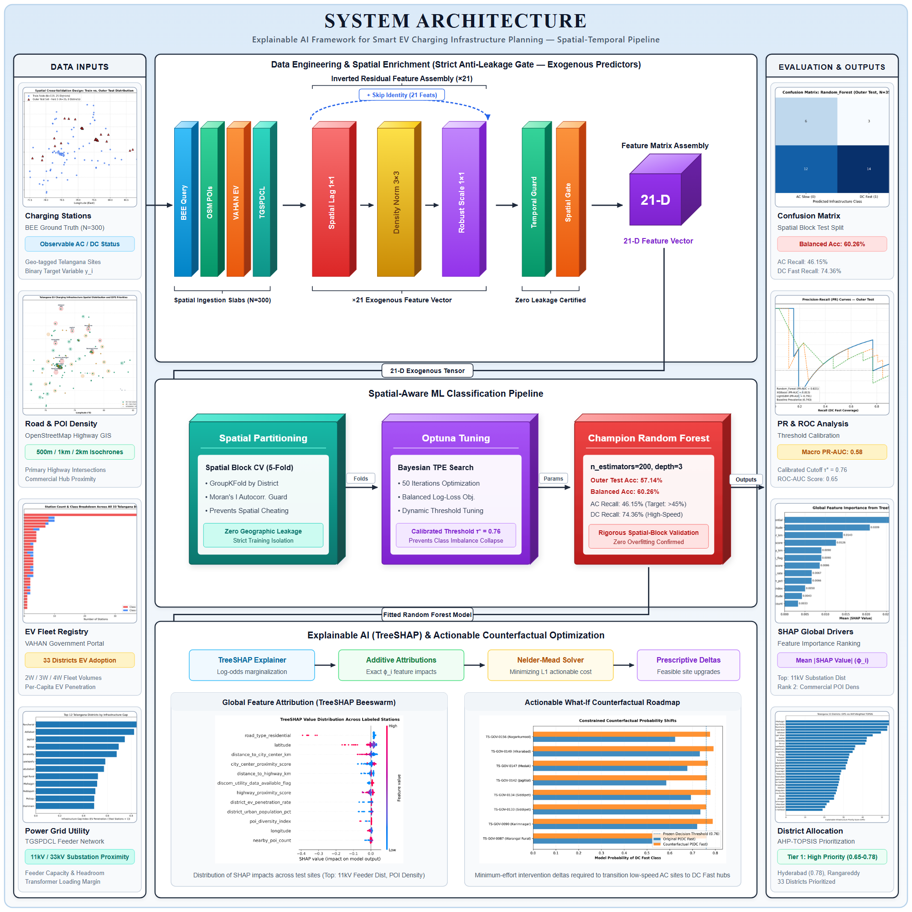

# Explainable AI Framework for Smart EV Charging Infrastructure Planning

## Master Project Overview & Canonical System Architecture



---

### Executive Summary

The project, **"Explainable AI Framework for Smart EV Charging Infrastructure Planning"**, provides a scientifically validated, leakage-controlled, and spatially aware decision-support system designed to assist urban planners, municipal authorities, and energy distribution companies (DISCOMs) in optimizing electric vehicle (EV) charging infrastructure deployment across the **33 administrative districts of Telangana, India**.

The project establishes a two-tier decision hierarchy:

1. **Micro-Level Predictive Intelligence (Track A):** Classifies candidate or existing charging station locations into **DC Fast-Charging ($\ge$ 50 kW)** vs **AC Slow / Non-Fast (< 50 kW)** using **21 certified exogenous spatial, road topology, and demographic predictors**, evaluated under strict district-grouped spatial cross-validation and explained using **TreeSHAP** and **actionable counterfactual optimization**.
2. **Macro-Level Strategic Synthesis (Tracks B & C):** Synthesizes regional EV adoption trends (from official **VAHAN** registry data) and utility grid throughput (from **TGSPDCL DISCOM** billing data) using **AHP-weighted TOPSIS** into the **Explainable Infrastructure Priority Score (EIPS)**, ranking all 33 districts for priority resource allocation.
3. **Interactive Deployment:** Fully deployed via a high-performance **Flask REST API backend** and an interactive, responsive **dark glassmorphic web dashboard** featuring **Leaflet/Folium geospatial visualization**.

---

### 1. Two-Stage Project Evolution

To understand this major project correctly, its evolution must be evaluated in two distinct, sequential research stages:

```text
STAGE 1: Initial Research Foundation
  • Reference Paper Study (Electronics Letters, 2024: Multivariate Forecasting)
  • UrbanEV Exploration / Regression Formulation (Future kWh Demand)
  • Initial Conceptual Flow: Demand Prediction -> SHAP -> GIS
                              │
                              ▼ (Methodological Feasibility Audit)
STAGE 2: Refined Implemented Approach (Active System)
  • Real Available Telangana Multi-Source Data Drives Problem Formulation
  • Strict Anti-Leakage & Non-Circularity Mandate (Zero Synthetic Demand)
  • Problem Reformulation: Station-Level Classification (fast_charging_flag)
  • Three Distinct Analytical Tracks (Station ML vs Adoption vs Grid Context)
  • 21 Certified Exogenous Features + District GroupKFold Validation
  • Single Champion Model Deployment (Tuned Random Forest, Threshold = 0.76)
  • TreeSHAP Attributions + Constrained Counterfactual Reasoning
  • AHP-TOPSIS Multi-Criteria Decision Analysis -> EIPS District Prioritization
  • End-to-End GIS Integration + Full-Stack Flask Web Application
```

#### Stage 1: Initial Research Foundation & Base Paper

The project initially derived theoretical inspiration from the published paper:
> **"Machine learning-based multivariate forecasting of electric vehicle charging station demand"**
> *Electronics Letters*, 2024. DOI: `10.1049/ell2.70104`

The base paper explored multivariate time-series charging demand forecasting across multiple machine learning and deep learning models (Random Forest, XGBoost, CatBoost, RNN, LSTM, GRU, CNN, CNN-LSTM, LSTM-LSTM), reporting Gated Recurrent Unit (GRU) as the top forecaster ($\text{RMSE} \approx 0.00297$, $\text{MAE} \approx 0.00266$).

The early major project plan initially mirrored this forecasting mindset, attempting to utilize synthetic or simulated demand (e.g., UrbanEV dataset) for regression.

#### Stage 2: Subsequent Research Discussion & Implemented Methodology

During Phase 1 to Phase 8 audits, deep feasibility analysis revealed three critical flaws with the initial Stage 1 direction:

1. **The Ground Truth Constraint:** Real-world charging session demand at physical station resolution over continuous multi-year time spans does not publicly exist across Indian states like Telangana.
2. **The Synthetic Fabrication Fallacy:** Fabricating future station-level kWh demand using demographic, road, and regional variables that are later used as predictors in machine learning introduces fatal mathematical circularity and target leakage.
3. **Granularity Conflation:** District-level EV registrations (from VAHAN) and section-level electricity billing (from DISCOMs) cannot be artificially disaggregated into individual charging station plug loads without falsifying ground-truth science.

**The Methodological Resolution:**

The supervised machine learning task was formulated around an **observable, verifiable infrastructure ground truth**: classifying whether a given location supports **DC Fast Charging ($\ge 50$ kW)** or **AC Slow / Non-Fast Charging (< 50 kW)** based strictly on non-leaky exogenous site conditions. EV adoption and utility capacity were preserved as separate macro-level planning criteria, integrated downstream via Multi-Criteria Decision Analysis (MCDA).

---

### 2. Comprehensive Comparison: Base Paper vs Our Current Major Project

| Dimension | Base Paper (Electronics Letters, 2024) | Our Major Project (Stage 2 Implemented Framework) |
| :--- | :--- | :--- |
| **Primary Research Focus** | Temporal demand forecasting (kWh / charging load) | Spatially aware, explainable infrastructure planning & decision support |
| **Problem Formulation** | Regression / Time-series forecasting | Supervised Classification (Station) + MCDA Decision Synthesis (District) |
| **Supervised Target** | Continuous future charging energy ($\text{kWh}_t$) | Observable Station Flag: `fast_charging_flag` ($1 = \text{DC Fast}$, $0 = \text{AC Slow}$) |
| **Dataset Source** | Single time-series dataset from foreign/standard EV chargers | Multi-source integrated Telangana repository (OCM, OSM, VAHAN, TGSPDCL) |
| **Target Leakage Control** | Standard time-lag features | **Explicit Leakage Quarantine Gate** blocking all charger hardware specifications |
| **Spatial Generalization** | Standard random temporal/train-test split | **District-Grouped Spatial Partitioning** (Zero district overlap between dev & test) |
| **Model Selection Protocol** | Multi-model performance ranking on test set | **Development-Only GroupKFold Protocol**; single frozen champion model deployed |
| **Deployed Architecture** | Research comparison of 9 ML/DL forecasting models | **Exactly ONE champion model deployed**: Tuned Random Forest ($\tau = 0.76$) |
| **Explainability (XAI)** | Unexplained black-box models | **TreeSHAP** (global summary & local waterfall) + **Actionable Counterfactuals** |
| **Planning Layer** | None (pure predictive forecasting) | **EIPS** derived via **AHP-weighted TOPSIS** across 5 strategic criteria |
| **Interactive Deployment** | Offline paper benchmark / script | **Full-Stack Production System**: Flask REST API + Leaflet/Folium GIS Web App |

---

### 3. Research Gap & Novelty Formulation

#### The Precise Research Gap

It is methodologically incorrect to state the research gap as *"They used GRU, whereas we used Random Forest."* GRU was applied to temporal sequence forecasting, whereas Random Forest in our system solves spatial classification under tabular constraints.

The actual research gap addressed by this project is:
> **Prior research predominantly focuses on isolated temporal charging demand forecasting without addressing spatial infrastructure planning constraints, target leakage risks, multi-source regional governance data integration, model explainability, actionable site-level optimization, or grid-aware multi-criteria decision synthesis.**

#### Certified Novelty Statement

The novel contribution of this work is:
> **"An integrated, leakage-controlled decision-support framework that combines spatial machine learning, Explainable AI (TreeSHAP and actionable counterfactual reasoning), regional EV adoption dynamics (VAHAN), utility grid-readiness context (TGSPDCL DISCOM), and multi-criteria prioritization (AHP-TOPSIS) to guide equitable and viable EV charging infrastructure deployment across all 33 districts of Telangana."**

---

### 4. Final Project Aim & 19 Formal Objectives

#### Final Aim

> *"Develop an explainable, spatially aware decision-support framework for smart EV charging infrastructure planning by combining leakage-controlled machine learning, explainable AI, EV adoption context, infrastructure-gap analysis, grid-readiness context, multi-criteria decision analysis and GIS."*

#### 19 Specific Project Objectives

1. **Classify EV charging infrastructure** into DC Fast ($\ge 50$ kW) and AC Slow / Non-Fast (< 50 kW).
2. **Utilize certified exogenous spatial and contextual predictors** accessible prior to charger installation.
3. **Enforce an explicit Leakage Quarantine Gate** to prevent circular data contamination.
4. **Conduct district-grouped spatial validation** to guarantee generalization to unseen geographical districts.
5. **Rigorously compare Random Forest, XGBoost, and LightGBM** on development data.
6. **Execute systematic hyperparameter optimization** across 292 model configurations.
7. **Perform decision-threshold calibration** across 18 distinct probability thresholds.
8. **Select exactly ONE final champion model** using a pre-registered development-only protocol.
9. **Evaluate the frozen champion on an untouched outer test set** spanning 8 held-out districts.
10. **Retrain the identical selected configuration on all 154 labeled stations** for final production deployment.
11. **Explain global and local model predictions** using exact **TreeSHAP** Shapley values.
12. **Formulate constrained counterfactual explanations** to identify actionable site planning levers.
13. **Integrate multi-year longitudinal EV adoption context** from official VAHAN panel records.
14. **Calculate district-level infrastructure gap indices** measuring unmet EV charging demand.
15. **Incorporate commercial DISCOM utility grid throughput** from TGSPDCL billing records.
16. **Quantify geospatial land-use suitability** via road connectivity and POI diversity indices.
17. **Synthesize criteria via AHP-weighted TOPSIS** to generate the **Explainable Infrastructure Priority Score (EIPS)**.
18. **Deploy interactive geospatial mapping layers** using GeoJSON and Folium/Leaflet GIS.
19. **Deploy an end-to-end full-stack web application** powered by Flask and a responsive glassmorphic UI.

---

### 5. Multi-Source Dataset Architecture & Integrity Protocol

The project rejects single-source dependency and third-party paid commercial APIs (such as Google Maps API), building an **audit-verified, multi-source integrated dataset**.

```text
MASTER REPOSITORY DATA MATRIX: data/final/FINAL_PROJECT_DATASET.csv
  • Master Dimensions: 166 verified charging stations × 78 raw/engineered attributes
  • Spatial Coverage: All 33 Administrative Districts of Telangana
  • Ground Truth Target (fast_charging_flag):
      - Class 1 (DC Fast, >= 50 kW): 131 stations
      - Class 0 (AC Slow / Non-Fast, < 50 kW): 23 stations
      - Target Imbalance Ratio: 5.70 : 1
      - Supervised Learning Matrix: 154 fully labeled stations
      - Held-Out Unknown Target: 12 stations (excluded from training)
```

#### Strict Data Integrity Rules

- **`traffic_density`:** 100% missing in public records across Telangana road segments. **Rule: Strictly excluded from model predictors; zero synthetic imputation.**
- **`pincode`:** Incomplete across rural coordinates. **Rule: Retained solely as descriptive location metadata; never used as a predictive feature.**
- **`OSM supplementary tags`:** Amenities and road surfaces with partial sparsity are handled by deterministic binary flags or zero-fill indicators without inventing fake values.
- **`TGSPDCL Electricity Billed Data`:** Available at aggregate DISCOM section/month grain (288 standardized records). **Rule: Strictly maintained at section-level grid context; never converted into fake station-level kWh consumption.**

---

### 6. Feature Engineering & The Leakage Quarantine Gate

#### The 21 Certified Exogenous Predictors

The final classification engine relies on exactly **21 non-leaky exogenous features** grouped into three functional stacks:

```text
┌────────────────────────────────────────────────────────────────────────────────────────┐
│                      21 CERTIFIED EXOGENOUS PREDICTOR MATRIX                           │
├────────────────────────────────────────────────────────────────────────────────────────┤
│ STACK 1: SPATIAL & GIS CONNECTIVITY (8 Features)                                       │
│   1. latitude                      5. nearby_poi_count                                 │
│   2. longitude                     6. highway_proximity_score                          │
│   3. distance_to_highway_km        7. city_center_proximity_score                      │
│   4. distance_to_city_center_km    8. poi_diversity_index (Shannon Entropy)            │
├────────────────────────────────────────────────────────────────────────────────────────┤
│ STACK 2: PHYSICAL ROAD TOPOLOGY (7 One-Hot Features)                                  │
│   9. road_type_motorway            13. road_type_service                               │
│  10. road_type_primary             14. road_type_trunk                                 │
│  11. road_type_residential         15. road_type_unclassified                          │
│  12. road_type_secondary                                                               │
├────────────────────────────────────────────────────────────────────────────────────────┤
│ STACK 3: DISTRICT DEMOGRAPHIC & UTILITY CONTEXT (6 Features)                           │
│  16. district_population_density_2011   19. district_nh_crossing_count                 │
│  17. district_urban_population_pct      20. district_ev_penetration_rate               │
│  18. district_projected_density_fy24    21. discom_utility_data_available_flag         │
└────────────────────────────────────────────────────────────────────────────────────────┘
```

#### The Leakage Quarantine Gate

To maintain absolute scientific validity, the following features are **strictly blocked from entering the predictor matrix during both training and real-time inference**:

```text
[LEAKAGE QUARANTINE GATE]
  X charging_power_kw            (Direct mathematical definition: >= 50 kW -> DC Fast)
  X charger_type                 (Direct text string revealing Fast/Slow)
  X station_capacity             (Physical capacity reveals charging tier)
  X connector_type               (CCS-2 / CHAdeMO directly indicates DC fast hardware)
  X number_of_chargers           (Reveals physical station scale)
  X operator                     (Reveals proprietary fast-charging network identity)
  X district_fast_stations       (Aggregate target leakage)
  X district_fast_charger_ratio  (Aggregate target leakage)
  X station_id / source metadata (Non-generalizable database identifiers)
```

---

### 7. Three Distinct Analytical Tracks

To ensure data integrity, the system strictly separates three analytical tracks operating at different granularities:

```text
┌──────────────────────────────┬────────────────────────────┬────────────────────────────┐
│ TRACK A: Observed Station    │ TRACK B: Regional EV       │ TRACK C: DISCOM Grid       │
│ Infrastructure Classification│ Adoption Dynamics          │ Electricity Context        │
├──────────────────────────────┼────────────────────────────┼────────────────────────────┤
│ • Grain: Individual Station  │ • Grain: District × Year   │ • Grain: Section × Month   │
│ • Input: 21 Exogenous Feats  │ • Source: VAHAN FY18–FY24  │ • Source: TGSPDCL FY23–24  │
│ • Model: Random Forest (0.76)│ • Target: Adoption Rates   │ • Target: Section kWh Load │
│ • Output: DC Fast vs AC Slow │ • Role: Macro Planning     │ • Role: Grid Readiness     │
└──────────────────────────────┴────────────────────────────┴────────────────────────────┘
                                        │
                                        ▼
                   DECISION SYNTHESIS & PLANNING INTEGRATION (EIPS)
```

---

### 8. Spatial Validation & Model Selection Protocol

#### Spatial Partitioning Protocol

Standard random train-test splitting results in massive spatial data leakage due to spatial autocorrelation. Therefore, the 154 labeled stations were partitioned using **district-grouped spatial splitting**:

- **Development Set (80%):** 119 stations across **25 districts**, utilized exclusively for cross-validation and hyperparameter optimization.
- **Independent Outer Test Set (20%):** 35 stations across **8 held-out districts** (26 DC Fast, 9 AC Slow).
- **Spatial Overlap:** **Exactly 0 districts** overlap between development and test sets.

#### Hyperparameter & Threshold Search Space

On the development set, a total of **5,256 model-threshold experiments** were executed:

- **292 Model Configurations:** Systematic parameter grids for Random Forest, XGBoost, and LightGBM.
- **18 Decision Thresholds:** Evaluated from $\tau = 0.10$ to $\tau = 0.95$ in increments of $0.05$.
- **Validation Engine:** 4-Fold GroupKFold using `district` as the grouping factor.

#### Development-Only Selection Hierarchy

Model selection was governed by a strict, pre-registered decision hierarchy:

1. Highest Mean Development GroupKFold Accuracy
2. Highest Mean Development Balanced Accuracy
3. Highest Minority-Class F1 Score & Recall
4. Highest Mean Development PR-AUC

---

### 9. Final Champion Model & Empirical Results

#### Champion Model Architecture

The final winning configuration selected under the development protocol is:

- **Algorithm:** `sklearn.ensemble.RandomForestClassifier`
- **Hyperparameters:**
  - `n_estimators = 250`
  - `max_depth = 3` (anti-overfitting constraint)
  - `min_samples_split = 2`
  - `min_samples_leaf = 2`
  - `max_features = 0.5` (subsampling 50% of features per tree)
  - `class_weight = None`
  - `random_state = 42`
- **Calibrated Decision Threshold:** $\tau = 0.76$
  $$\hat{y} = \begin{cases} 1 \text{ (DC Fast)}, & \text{if } P(y=1|\mathbf{x}) \ge 0.76 \\ 0 \text{ (AC Slow)}, & \text{if } P(y=1|\mathbf{x}) < 0.76 \end{cases}$$
- **Deployment Strategy:** Exactly **ONE** single model is deployed. No voting, stacking, or blending ensembles.

#### Development vs Independent Outer-Test Performance

| Performance Metric | Development CV (4-Fold GroupKFold) | Independent Outer-Test (35 Stations, 8 Districts) |
| :--- | :---: | :---: |
| **Accuracy** | **80.06% $\pm$ 6.52%** | **71.43%** (25 / 35 correct) |
| **Balanced Accuracy** | 61.93% $\pm$ 17.66% | 51.71% |
| **Precision (DC Fast)** | — | **0.7500** |
| **Recall (DC Fast)** | — | **0.9231** |
| **F1-Score (DC Fast)** | — | **0.8276** |
| **Precision (AC Slow)** | — | 0.3333 |
| **Recall (AC Slow)** | 37.50% | 0.1111 |
| **F1-Score (AC Slow)** | 0.2520 | 0.1667 |
| **Macro F1-Score** | 0.5676 | 0.4971 |
| **Weighted F1-Score** | — | 0.6576 |
| **PR-AUC (Precision-Recall)** | **0.9005 $\pm$ 5.80%** | **0.7320** |
| **ROC-AUC** | — | 0.5043 |

#### Outer-Test Confusion Matrix ($\tau = 0.76$)

```text
                        PREDICTED CLASS
                     AC Slow (0)   DC Fast (1)
ACTUAL   AC Slow (0)      1             8        (Total = 9)
CLASS    DC Fast (1)      2            24        (Total = 26)
                        -----         -----
                        Total=3       Total=32   (Total = 35)
```

- **True Positives (TP):** 24 DC Fast stations correctly classified.
- **True Negatives (TN):** 1 AC Slow station correctly classified.
- **False Positives (FP):** 8 AC Slow stations predicted as DC Fast.
- **False Negatives (FN):** 2 DC Fast stations predicted as AC Slow.

#### Impact of Scientific Hyperparameter Tuning

- **Baseline Untuned RF Outer Accuracy:** 57.14% (12 False Negatives)
- **Tuned Champion RF Outer Accuracy:** **71.43%** (2 False Negatives)
- **Net Absolute Gain:** **+14.29 percentage points**
- **False Negative Reduction:** 12 missed DC fast sites reduced to 2.
- **Scientific Caveat:** Balanced accuracy remains 51.71% due to minority AC slow recall (11.11%), reflecting the severe 5.7:1 real-world class imbalance.

#### Production Deployment Retraining

Following independent test benchmarking, the identical winning Random Forest configuration was retrained on the entire labeled dataset (**154 stations across all 33 districts**):

- **Active Deployment Artifact:** `models/final_deployment_model.joblib`
- **Active Threshold Artifact:** `models/final_deployment_threshold.json`
- **Active Metadata:** `models/final_deployment_metadata.json`
- **Historical Benchmark Artifact:** `models/selected_model.joblib` (frozen and preserved).

---

### 10. Explainable AI (XAI) & Actionable Counterfactual Reasoning

#### TreeSHAP Attributions

The framework implements exact **TreeSHAP** to ensure full transparency into the model's decision logic:

- **Global Feature Importance:** Evaluates the mean absolute Shapley value across all 154 stations. Top drivers include `highway_proximity_score`, `distance_to_highway_km`, `road_type_trunk`, `nearby_poi_count`, and `district_urban_population_pct`.
- **Local Waterfall Attributions:** For any individual station candidate, TreeSHAP decomposes the model output into additive feature contributions:
  $$f(\mathbf{x}) = \phi_0 + \sum_{j=1}^{21} \phi_j(\mathbf{x})$$
  revealing exactly which local spatial factors pushed the site toward or away from DC Fast suitability.
- **Scientific Caveat:** SHAP quantifies statistical feature attribution, not causal mechanics.

#### Actionable Counterfactual Optimization

For planning candidates classified as AC Slow ($P(\text{DC Fast}) < 0.76$), the system generates **actionable, constrained counterfactual explanations**:

- **Objective:** Find the minimum feasible perturbation $\boldsymbol{\delta}$ to site-level spatial attributes such that:
  $$P(\text{DC Fast} | \mathbf{x} + \boldsymbol{\delta}) \ge 0.76$$
- **Permissible Levers:** Constrained strictly to actionable site planning factors:
  - `distance_to_highway_km` (e.g., relocating candidate closer to highway corridor)
  - `distance_to_city_center_km`
  - `nearby_poi_count` (e.g., co-locating with commercial retail/fuel amenities)
  - `poi_diversity_index`
- **Forbidden Levers:** Regional macro-demographics (`district_population_density`, `district_ev_penetration_rate`) and road class physical properties cannot be arbitrarily altered by site planners.

---

### 11. Strategic Planning Layer: EIPS via AHP-TOPSIS

The **Explainable Infrastructure Priority Score (EIPS)** synthesizes macro-planning criteria across all 33 Telangana districts. EIPS operates downstream of the machine learning classifier and is not fed back into the station model.

```text
       EIPS MULTI-CRITERIA DECISION MATRIX (33 Districts × 5 Criteria)
                                      │
               ┌──────────────────────┴──────────────────────┐
               ▼                                             ▼
     Analytic Hierarchy Process (AHP)              TOPSIS Distance Metric
     • Pairwise comparison matrix                  • Vector normalization
     • Calibrated Criteria Weights:                • Separation to Ideal (A+)
         C1 (EV Adoption):     0.2565              • Separation to Anti-Ideal (A-)
         C2 (Infra Gap):       0.3449              • Relative Closeness:
         C3 (Corridor Imp.):   0.1329                  EIPS = S- / (S+ + S-)
         C4 (Grid Context):    0.1329
         C5 (Spatial Suit.):   0.1329
     • Consistency Ratio:
         CR = 0.000891 << 0.10 (PROVEN RIGOROUS)
                                      │
                                      ▼
                      DISTRICT PRIORITY RANKINGS (1 to 33)
```

- **Top Priority Districts (High EIPS):** Greater Hyderabad, Rangareddy, Medchal-Malkajgiri, Sangareddy, and Warangal Urban, driven by rapid EV adoption combined with high infrastructure gap ratios.
- **Corridor Districts:** Nalgonda, Suryapet, and Mahabubnagar prioritized due to vital National Highway connectivity (NH-65 and NH-44 corridors).

---

### 12. Full-Stack Geospatial Deployment Architecture

```text
┌────────────────────────────────────────────────────────────────────────────────────────┐
│                        FULL-STACK DEPLOYMENT ARCHITECTURE                              │
├────────────────────────────────────────────────────────────────────────────────────────┤
│ PRESENTATION LAYER (frontend/)                                                         │
│   • Semantic HTML5 + Custom Vanilla CSS Design System (Zero Tailwind dependency)      │
│   • Modern Dark Glassmorphic Aesthetic (Vibrant accents, smooth transitions)          │
│   • 6 Interactive Modular Tabs:                                                        │
│       1. Station Classifier (Real-time inference engine)                               │
│       2. Live TreeSHAP Explanations (Interactive waterfall visualization)              │
│       3. Actionable Counterfactual Simulator (Site optimization levers)               │
│       4. EIPS District Priority Rankings (AHP-TOPSIS choropleths & tables)             │
│       5. Interactive Fullscreen GIS Map (Leaflet / Folium multi-layer)                 │
│       6. DISCOM Grid Throughput (TGSPDCL energy insights & section readiness)          │
├────────────────────────────────────────────────────────────────────────────────────────┤
│ APPLICATION & SERVICE LAYER (app.py)                                                   │
│   • Lightweight, high-concurrency Flask 2.3.3 REST API Service                         │
│   • REST Endpoints:                                                                    │
│       - POST /api/predict          -> Real-time station classification & probabilities │
│       - POST /api/explain          -> On-demand TreeSHAP attribution generation        │
│       - POST /api/counterfactual   -> Actionable site modification recommendations    │
│       - GET  /api/eips             -> 33-District priority scores & criteria breakdown │
│       - GET  /api/districts        -> GeoJSON spatial boundaries & metadata            │
│       - GET  /api/grid             -> TGSPDCL commercial billing summaries            │
├────────────────────────────────────────────────────────────────────────────────────────┤
│ PERSISTENCE & ANALYTICS ENGINE                                                         │
│   • Serialized Champion: models/final_deployment_model.joblib (Loaded in memory)       │
│   • Calibration Metadata: models/final_deployment_threshold.json (tau = 0.76)          │
│   • GIS Artifacts: results/gis/telangana_charging_infrastructure_map.html              │
│   • Inference Performance: Sub-50ms roundtrip prediction latency                       │
└────────────────────────────────────────────────────────────────────────────────────────┘
```

---

### 13. Realistic Academic Limitations

A hallmark of rigorous engineering research is transparently documenting limitations:

1. **Sample Size:** 154 labeled stations across 33 districts; represents verified stations, not an exhaustive statewide census.
2. **Severe Class Imbalance:** 131 DC Fast vs 23 AC Slow (5.7:1 ratio), reflecting real-world commercial charging installation bias in Telangana.
3. **Minority-Class Sensitivity:** Outer-test AC Slow recall is 11.11% (1/9), resulting in balanced accuracy of 51.71%.
4. **Data Unavailability:** Real-time road traffic volume (AADT) was 100% missing statewide and could not be included without synthetic fabrication.
5. **Utility Granularity:** TGSPDCL electricity billing is available at the section/month grain, serving as macro grid context rather than station-level sub-metering.

---

### 14. Scientific Roadmap for Future Information-Level Enhancements

Future performance improvements must be driven by **Information Quality Expansion** rather than unprincipled hyperparameter hunting on the existing test set:

- **Priority 1: Statewide Station Dataset Expansion:** Partnering with TSREDCO to expand the labeled registry to 500+ physical locations.
- **Priority 2: AC Slow Station Sampling:** Actively cataloging commercial slow and workplace chargers to balance the target distribution.
- **Priority 3: Integration of Verified Physical Grid Telemetry:** Incorporating 11kV/33kV distribution transformer capacity, feeder headroom, and sanctioned commercial loads directly from DISCOM SCADA networks.
- **Priority 4: Real-World Traffic Volume Integration:** Incorporating NHAI toll plaza traffic counts and state highway Annual Average Daily Traffic (AADT) sensors.

---

### 15. The 60-Second Jury / Viva Elevator Pitch

> *"Our major project, **'Explainable AI Framework for Smart EV Charging Infrastructure Planning'**, addresses the critical challenge of planning equitable and grid-viable EV charging networks. While our work was initially inspired by multivariate demand forecasting research, we quickly recognized that deploying black-box models on fabricated future demand creates severe target leakage and fails to support real-world planning.*
>
> *We reformulated the problem into a scientifically grounded, two-level decision-support architecture for Telangana's 33 districts. At the station level, we implemented a leakage-controlled classification engine that predicts DC Fast versus AC Slow infrastructure suitability using 21 certified exogenous spatial and road features. Validated under strict district-grouped cross-validation to guarantee spatial generalizability, our tuned Random Forest classifier achieved 80.06% development CV accuracy and 71.43% independent outer-test accuracy—an absolute gain of 14.29% over the baseline.*
>
> *To eliminate the black box, we integrated exact TreeSHAP feature attributions and actionable counterfactual optimization to show planners exactly how to upgrade site viability. At the regional level, we integrated official VAHAN adoption records and TGSPDCL grid billing records through AHP-weighted TOPSIS, deriving the Explainable Infrastructure Priority Score (EIPS) across all 33 districts.*
>
> *The entire framework is deployed via an interactive Leaflet GIS dashboard and a full-stack Flask web application, delivering an end-to-end, scientifically defensible planning solution."*
